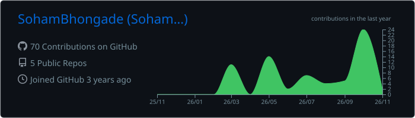
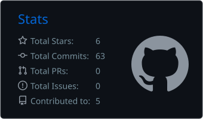
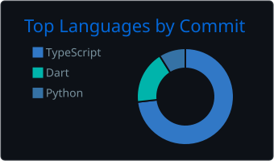
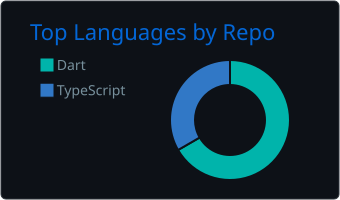
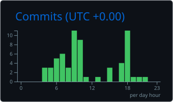

  

---

## About

I'm a student developer who builds practical software that real people use every day: **Tareeq**, an AI civic-reporting platform for Ras Al Khaimah (website + Android app), a role-based college management portal, a gamified step-tracking platform for student wellbeing, and a desktop library system for my college. I care about clean interfaces, reliable data and software that people without any coding knowledge can install and use.

---

## GitHub Achievements

<!-- ACHIEVEMENTS:START -->

  
  
  

Pull Shark &nbsp;·&nbsp; Quickdraw &nbsp;·&nbsp; YOLO

<!-- ACHIEVEMENTS:END -->

---

## Tech Stack

  
    
  

---

## Featured Projects

### 🛣️ Tareeq (طريق)
> **Spot it. Snap it. Fixed. AI civic reporting for Ras Al Khaimah**

Tareeq turns every resident's phone into a city sensor. Snap a photo of a pothole, a broken streetlight or a pile of rubbish, and **Google Gemini** names the problem, scores how dangerous it is and writes a description in **English and Arabic**. The report lands on a **live city map** with its exact GPS location, and city crews or community volunteers fix it. It started as *FixMyStreet AI* (a Flutter app) and was rebuilt as a website plus an Android app for the **RAK Department of Knowledge × Google** hackathon.

▶ Click to watch the 95-second launch video

**What it does**

- **AI Triage:** Gemini picks one of 15 issue categories, a 1–10 severity and an English + Arabic description from a single photo.
- **Live Map:** Every report is colour-coded by danger, and the list refreshes every 3 seconds.
- **Duplicate Detection:** If the same issue is already reported within 60 m, residents confirm it instead of filing it again.
- **Volunteer Pipeline:** Minor jobs go to volunteers, whose proof photos a City Admin approves.
- **Fake-Photo Protection:** AI-generated images are refused (file labels, a vision check and a signed server-side photo pass).
- **Gamification:** EXP, a leaderboard, 8 badges and 29 avatars.
- **Arabic, Dark Mode and Phones:** Full right-to-left Arabic, light/dark themes and a phone layout built for small screens.

**Technology Stack**

| Layer | Technology |
|---|---|
| Frontend | **Next.js 16**, **React 19**, **TypeScript**, **Tailwind CSS v4** |
| AI | **Google Gemini** vision, with **Groq** as the backup |
| Database | **MongoDB Atlas** |
| Hosting | **Vercel**, auto-deployed from GitHub |
| Android | Java **WebView** app, APK built by **GitHub Actions** |

  
  
  

Built with **Abhinav Arul**, **Aneeq Mohammed** and **Nithik Dev** · Indian Public High School Private, Ras Al Khaimah

 

### 🏛️ ICP Portal
> **College Management Web Portal**

A secure web portal that brings the college's day-to-day administration into one place. Each user signs in with a role (**Admin, Faculty, Staff or Student**) and sees only the tools meant for them.

**What it does**

- **Attendance:** Faculty mark attendance and admins see an overview across courses.
- **Fees:** Fee ledgers for every student, including development fees and scholarships.
- **User Management:** Create and edit users, manage custom fields and bulk-import students from CSV.
- **Account Requests:** New users request an account and admins approve or reject it.
- **Support Desk:** Built-in support requests between users and the admin team.

**Technology Stack**

| Layer | Technology |
|---|---|
| Framework | **Next.js** with **React** and **TypeScript** |
| Styling | **Tailwind CSS** |
| Database | **Turso (libSQL)** with **Drizzle ORM** |
| Security | Hashed passwords and signed session cookies |

  

 

### 👟 StrideBoard
> **Gamified Step Tracking for Student Wellbeing**

StrideBoard turns daily walking into a friendly competition. It was built for the **AL SOUT 2026 "Play, Code, Create: AI Innovation Challenge"**, a student wellbeing competition in Ras Al Khaimah.

**How it works**

- **Phone integration:** Steps are sent automatically from an **iOS Shortcut** or the **Android app**.
- **Backend API:** A Python backend receives and stores step data for every participant.
- **Web dashboard:** Students follow their progress and see how they compare on the board.

**Technology Stack**

| Layer | Technology |
|---|---|
| Backend | **Python** with a step-upload API |
| Mobile | **Android app** and **iOS Shortcuts** |
| Hosting | **PythonAnywhere** |

  

 

### More Projects

| Project | Description | Tech |
|---|---|---|
| [**ICP Library Management System**](https://github.com/SohamBhongade/ICP-Library-Management-System) | Official desktop library system for Imperial College of Pharmacy: book inventory, student records, issue/return, Excel and PDF reports. [Download for Windows (v3.2)](https://github.com/SohamBhongade/ICP-Library-Management-System/releases/download/v3.2/ICP_Library_System_Setup.exe) | Flutter · Dart · SQLite · Inno Setup |
| [**Fix My Street**](https://github.com/SohamBhongade/Fix_My_Street) | The original Flutter civic-reporting app that became **Tareeq** | Flutter · Dart · MongoDB |

---

## GitHub Stats

  

  
  

  
  

  

  <picture>
    <source media="(prefers-color-scheme: dark)" srcset="https://raw.githubusercontent.com/SohamBhongade/sohambhongade/output/github-contribution-grid-snake-dark.svg" />
    <source media="(prefers-color-scheme: light)" srcset="https://raw.githubusercontent.com/SohamBhongade/sohambhongade/output/github-contribution-grid-snake.svg" />
    
  </picture>

---

## Connect

  

  

