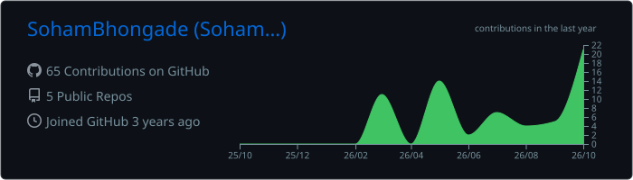
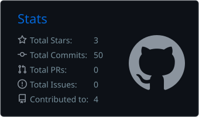
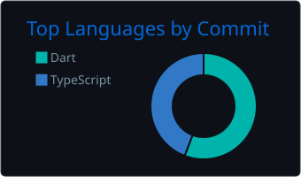
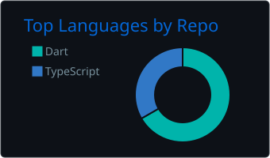
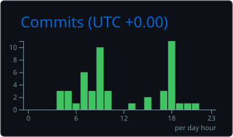

  

---

## About

I'm a student developer who builds practical software that real institutions use every day: a desktop library system for my college, a role-based college management portal, and a gamified step-tracking platform for student wellbeing. I care about clean interfaces, reliable data and software that people without any coding knowledge can install and use.

---

## GitHub Achievements

<!-- ACHIEVEMENTS:START -->

  
  

Quickdraw &nbsp;·&nbsp; YOLO

<!-- ACHIEVEMENTS:END -->

---

## Tech Stack

  
    
  

---

## Featured Projects

### 📚 ICP Library Management System
> **Official Desktop Solution for Library Management**

This application is a professional desktop solution designed to digitize and simplify the management of library operations. It replaces manual paperwork with a fast, reliable and user-friendly digital interface.

**What it does**

- **Inventory Tracking:** Manage a complete digital database of all books in the library.
- **Student Management:** Track student library records and borrowing history.
- **Transaction System:** Quickly issue and return books with automated status updates.
- **Professional Reporting:** Generate and export library data directly to **Excel** and **PDF** for official college records.

**Technology Stack**

| Layer | Technology |
|---|---|
| Frontend | **Flutter (Dart)** for a modern UI |
| Database | **SQLite** for high-speed, local data storage |
| File Services | Automated **Excel / PDF** generation |
| Distribution | Windows executable packaged with **Inno Setup** |

**How to Install**

You don't need any coding knowledge to use this app:

1. **Download** the setup file using the button below.
2. **Run** the downloaded file and follow the on-screen instructions.
3. **Launch** the **ICP Library System** icon on your Desktop.

  
  

**Soham Bhongade**, Lead Developer · Copyright © 2026 · Imperial College of Pharmacy

 

### 🏛️ ICP Portal
> **College Management Web Portal**

A secure web portal that brings the college's day-to-day administration into one place. Each user signs in with a role (**Admin, Faculty, Staff or Student**) and sees only the tools meant for them.

**What it does**

- **Attendance:** Faculty mark attendance and admins see an overview across courses.
- **Fees:** Fee ledgers for every student, including development fees and scholarships.
- **User Management:** Create and edit users, manage custom fields and bulk-import students from CSV.
- **Account Requests:** New users request an account and admins approve or reject it.
- **Support Desk:** Built-in support requests between users and the admin team.

**Technology Stack**

| Layer | Technology |
|---|---|
| Framework | **Next.js** with **React** and **TypeScript** |
| Styling | **Tailwind CSS** |
| Database | **Turso (libSQL)** with **Drizzle ORM** |
| Security | Hashed passwords and signed session cookies |

  

 

### 👟 StrideBoard
> **Gamified Step Tracking for Student Wellbeing**

StrideBoard turns daily walking into a friendly competition. It was built for the **AL SOUT 2026 "Play, Code, Create: AI Innovation Challenge"**, a student wellbeing competition in Ras Al Khaimah.

**How it works**

- **Phone integration:** Steps are sent automatically from an **iOS Shortcut** or the **Android app**.
- **Backend API:** A Python backend receives and stores step data for every participant.
- **Web dashboard:** Students follow their progress and see how they compare on the board.

**Technology Stack**

| Layer | Technology |
|---|---|
| Backend | **Python** with a step-upload API |
| Mobile | **Android app** and **iOS Shortcuts** |
| Hosting | **PythonAnywhere** |

  

 

### More Projects

| Project | Description | Tech |
|---|---|---|
| [**Fix My Street**](https://github.com/SohamBhongade/Fix_My_Street) | Civic issue reporting app | Flutter · Dart |

---

## GitHub Stats

  

  
  

  
  

  

  <picture>
    <source media="(prefers-color-scheme: dark)" srcset="https://raw.githubusercontent.com/SohamBhongade/sohambhongade/output/github-contribution-grid-snake-dark.svg" />
    <source media="(prefers-color-scheme: light)" srcset="https://raw.githubusercontent.com/SohamBhongade/sohambhongade/output/github-contribution-grid-snake.svg" />
    
  </picture>

---

## Connect

  

  

